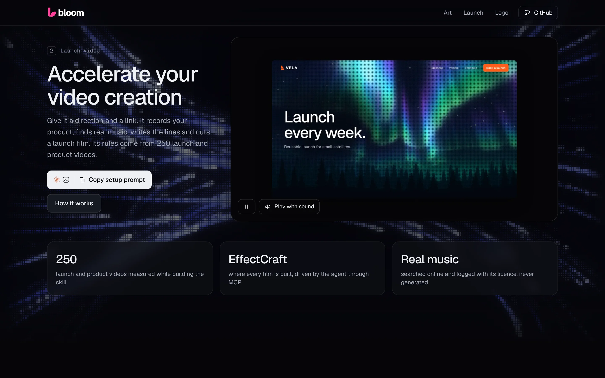
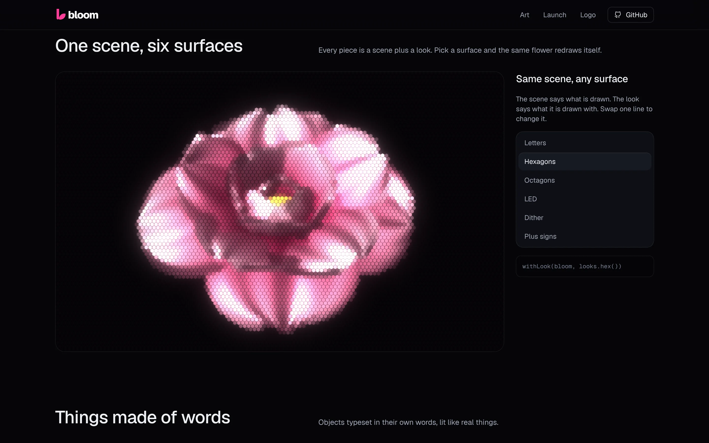

<p align="center">
  
</p>

<h1 align="center">Bloom</h1>

<p align="center">
  Three agent skills that make the art for your site, your launch film and your logo, plus the site that shows them off.
</p>

<p align="center">
  <a href="LICENSE"></a>
  
  
</p>

## Screenshots

<p align="center">
  
</p>

<table>
  <tr>
    <td width="50%"></td>
    <td width="50%"></td>
  </tr>
  <tr>
    <td width="50%"></td>
    <td width="50%"></td>
  </tr>
</table>

## What it is

Bloom is a monorepo of three skills for Claude Code and Codex. You bring the idea. The skills cover how the site looks, the launch video and the brand.

| | Skill | What it does | Folder |
|---|---|---|---|
| 1 | Dot Art | Animated art made of hexagons, LED pixels, dither or letters, dropped into your project as a React component | `skills/dot-art` |
| 2 | Launch Video | A launch film from a direction and a link: product capture, real music, short lines, cut to the beat in EffectCraft | `skills/video-editor` |
| 3 | Brand Creator | A logo, wordmark and full brand kit from a company name, based on research on 8,332 real tech logos | `skills/brand-creator` |

The site in `site/` shows each skill with real work it made: every dot art scene running live, a launch film, and five brands built with the brand builder (Vela, Bloom, Kite, Halo and Tessel). Bloom's own logo came out of Brand Creator.

## Set up a skill

The quickest way is the site: every skill has a **Copy setup prompt** button. Paste the prompt into Claude Code or Codex and the agent clones only that skill's folder from this repo, installs it in the right skills folder for itself, checks what it needs and tells you what is missing. The prompts are built in `site/lib/prompts.ts`.

To do it by hand, for example for Dot Art in Claude Code:

```bash
git clone --depth 1 --filter=blob:none --sparse https://github.com/edison16a/bloom.git /tmp/bloom
```

```bash
git -C /tmp/bloom sparse-checkout set skills/dot-art
```

```bash
cp -R /tmp/bloom/skills/dot-art ~/.claude/skills/dot-art && cd ~/.claude/skills/dot-art/scripts && npm install
```

For Codex, use `~/.codex/skills` instead. Launch Video and Brand Creator are workspaces with their own scripts, so copy them to a folder such as `~/bloom` and link the skill inside (`.claude/skills/<name>`) into your skills folder. Each one's README lists what it needs.

## How it works

Each skill is a folder with a `SKILL.md` that tells the agent how to work, plus the scripts and references it uses. The skills were copied into this repo as they are and are never edited by the site.

- **Dot Art** is a WebGL2 engine with no runtime dependencies. A scene describes what is drawn with a little GLSL, a photo, a shape or a model. The engine renders it into a low resolution grid and draws each cell as a mark or a letter. Every loop is seamless.
- **Launch Video** turns a direction into a one page plan, records the real product, finds music with `tools/source.py`, builds the film in EffectCraft through MCP, and checks the render with `gate.py` for loudness, peaks and black frames.
- **Brand Creator** writes a brief, renders candidates, shows three to five finished options, then builds the chosen one into 18 SVGs, 42 PNGs, a brand board and a zip with `scripts/build_brand.py`.

## Technical details

The site is a static Next.js 15 app in TypeScript, exported to plain HTML, CSS and JS in `site/out`.

```
site/
  app/            routes: home, /art, /launch, /logo
  components/     one folder per feature: art, launch, logo, setup, home, layout, ui
  content/        plain data: skills, art catalog, brands, films, launch facts
  lib/            setup prompt builder, client scene registry, clipboard
  scripts/        sync-dot-art.mjs copies the engine in from skills/dot-art
  tests/          vitest: prompts, content integrity, writing rules
  public/media/   brand kits, the launch film, screenshots of the brand boards
showcase/
  launch-film/    source of the launch film and its music licence
skills/           the three skills, unchanged
assets/brand/     the Bloom logo and its brand.json
```

- **Live dot art.** `npm run sync` runs the dot-art skill's own installer to copy the engine into `site/components/dot-art`, the same way the skill's gallery does. Scenes hold GLSL and functions, so pages pass scene ids and the client registry in `lib/scenes.ts` looks them up. Each canvas starts near the viewport, pauses off screen and gives its WebGL context back after 4 seconds away. Scenes that build up from nothing can start part way into their loop.
- **Design.** The interface follows the [unslop](https://github.com/heydamir/unslop) passes: one ink ramp, three text roles, one pink accent taken from the logo, Geist and Geist Mono, a 4 px spacing grid and one easing curve. The richness lives in the dot art, the film and the logos, not in the chrome.
- **The launch film.** It follows the Launch Video skill's film shape, motion values and sound rules. EffectCraft is a macOS app and was not available in the cloud container the site was built in, so the same plan was rendered from a web page frame by frame with live dot art, then mastered to -14.2 LUFS and -3.9 dBTP and checked with the skill's gate. `showcase/launch-film/README.md` has the details.
- **Brands.** All five were made with the brand builder from `skills/brand-creator`: candidates, an options sheet, then the full kit for option 1. Each `brand.json` the builder read sits next to its media in `site/public/media/brands`.
- **Tests.** `npm test` checks that every setup prompt clones only its own skill and covers both agents, that every file the site links to exists, and that no source uses em dashes, midline dots or arrows.

## Start the project

You need Node 20 or newer.

```bash
cd site
```

```bash
npm install
```

```bash
npm run dev
```

Open http://localhost:3000. The `dev` and `build` scripts run the dot-art sync first.

```bash
npm run build
```

```bash
npm test
```

`npm run build` writes the static site to `site/out`, ready for any static host.

## Credits

- Music in the launch film: "Newer Wave" by Kevin MacLeod (incompetech.com), licensed under CC BY 4.0.
- Fonts bundled with Brand Creator are under the SIL Open Font License.
- Interface direction follows unslop by Damir Sokolovsky, CC BY 4.0.

## License

MIT. See [LICENSE](LICENSE).
