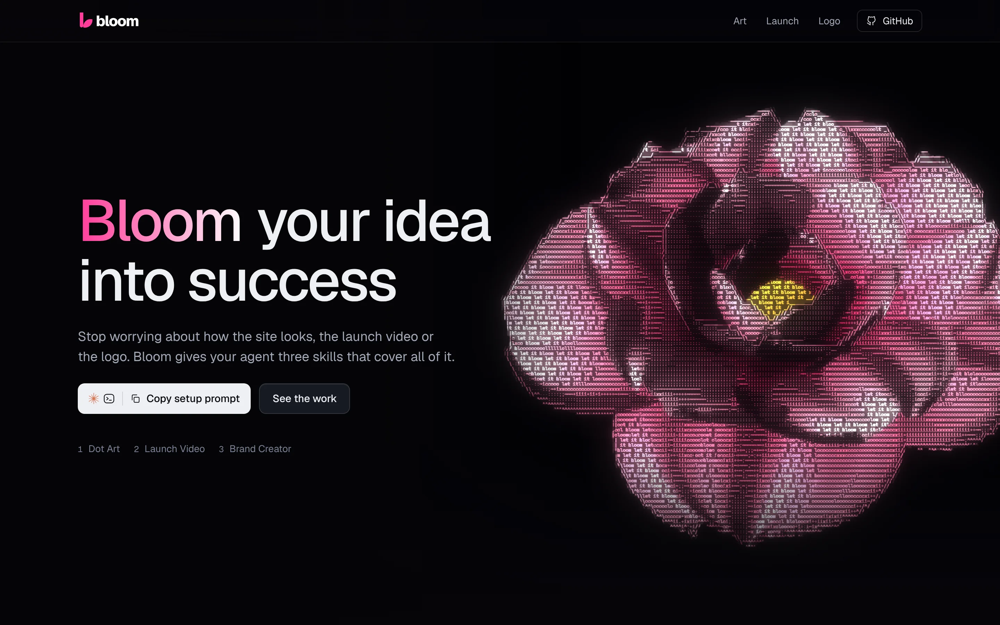
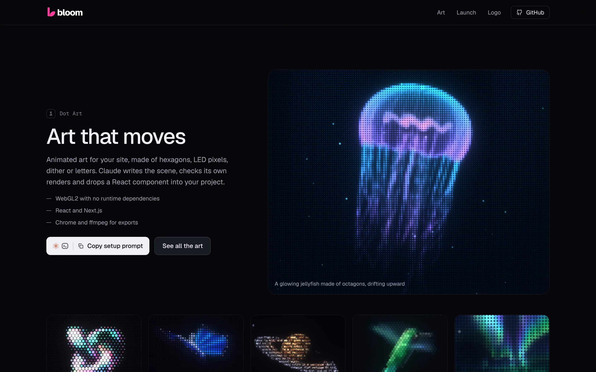
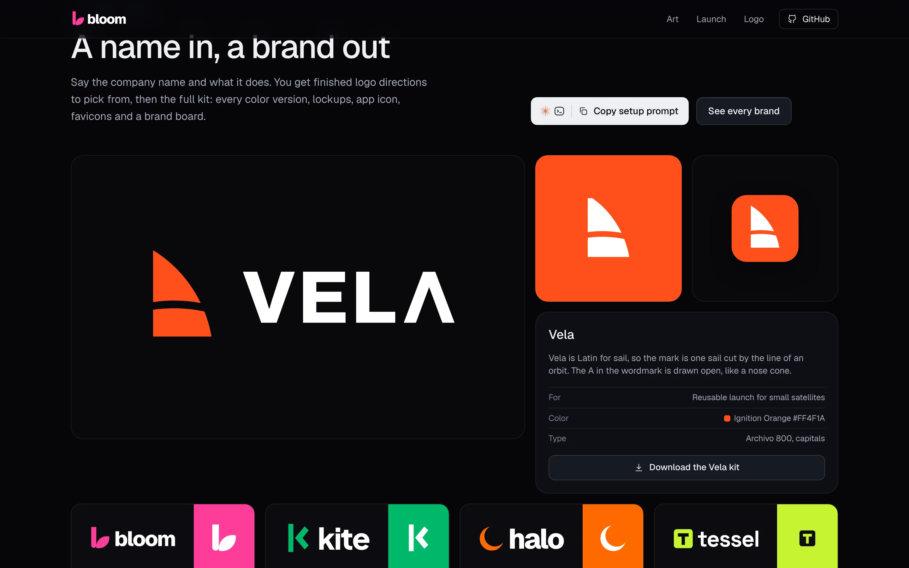

  

<h1 align="center">Bloom</h1>

  Three agent skills that make the art for your site, your launch film and your logo, plus the site that shows them off.

  
  
  

## Screenshots

  

<table>
  <tr>
    <td width="50%"></td>
    <td width="50%"></td>
  </tr>
  <tr>
    <td width="50%"></td>
    <td width="50%"></td>
  </tr>
</table>
