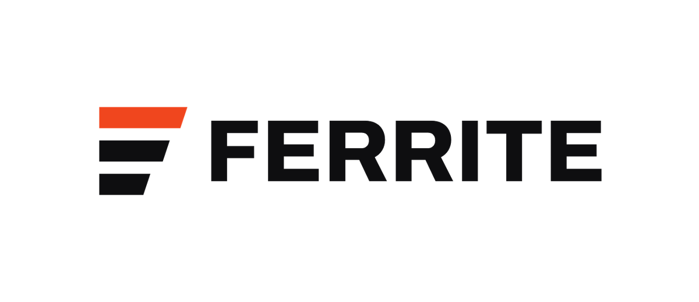

<p align="center">
  
</p>

<h1 align="center">Brand Creator</h1>

<p align="center">
  A Claude Code skill that turns a company name into a professional logo, wordmark and full brand kit, using research on 8,332 real tech logos.
</p>

<p align="center">
  
  
  
</p>

## What it does

Tell Claude "create a brand for Acme, we make X". It first shows you three to five finished logo directions side by side and asks which one you want. Once you pick, it builds everything a startup needs for that choice: the logo in brand color, black, white and reverse, a wordmark, horizontal and stacked lockups, an app icon, favicons, a named palette and a brand board you can open in any browser. Every file comes as SVG with the type converted to outlines, and as transparent PNG.

Then keep talking to it. "Make the color more purple", "use option 3", "bigger text" or "give me the full assets" edit one spec file and rebuild the whole kit.

Nothing is a template. Every symbol is drawn fresh for the name, and the choices follow what the research found separates strong logos from weak ones: simple flat shapes, a designed initial or one geometric idea, one or two saturated colors, and a tight, heavy wordmark.

## Screenshots


| | |
|---|---|
|  |  |
|  |  |

These are made up companies from test runs: a savings app, a developer tool, an AI accounting company and a chip maker. Each was designed by an agent that only read the skill. This repo's own logo was made the same way.

## Technical details

**The research.** 8,332 logo files from 6,259 brands: every simple-icons brand with its official hex, gilbarbara/logos, svgl's modern tech and AI set, 1,703 YC companies that reached Series A or later or were acquired, and 246 Wikidata tech companies (Wikimedia rate limits stopped that download early). Every file was measured from pixels in headless Chrome (shape, color clusters, symmetry, lockup proportions) and labeled by eye from contact sheets (symbol kind, container, style, simplicity, craft, and for wordmarks the typeface class, case, weight, tracking and custom detail). Fifty iconic brands such as NVIDIA, SpaceX, Anthropic, OpenAI, Stripe and Linear have written case studies.

**What it found** (`research/patterns.md`):

| Finding | Number |
|---|---|
| Simplest symbols rated professional (craft 4+) | 42%, against 8% for intricate ones |
| Flat or cut out style rated professional | 41%, against 21% for detailed or shaded |
| Strong symbols with no container | 62% |
| Strong full color logos using one or two colors | 74% |
| Tight tracking in strong wordmarks | 42%, against 14% in weak ones |
| Light weight wordmarks rated strong | 0 of 23 |
| Gap between symbol and word in real lockups | about 0.20 of the symbol height |

**The builder** (`scripts/build_brand.py`) reads a `brand.json`, sets the wordmark from 43 bundled SIL Open Font License fonts with real GPOS kerning (fontTools), converts it to outlines, measures each symbol's ink in Chrome so every lockup is optically balanced, and writes 18 SVGs, 42 PNGs, an offline `brand-board.html` (color pickers, any export size, client side zip) and a `<name>-brand-kit.zip`.

## How it works

1. **Brief.** Claude writes five lines: what the company does, its category archetype, three adjectives, a color strategy and how competitors look.
2. **References.** `scripts/examples.py` pulls matching strong logos from the research set into a contact sheet to study proportions and restraint.
3. **Candidates.** 10 to 16 wordmarks and 16 to 24 original symbols, rendered by `scripts/preview.py` in color, one color, as an app icon and at 32 and 16 px, so weak ideas show themselves.
4. **Color.** Black led or one named saturated color, tried on the best lockup.
5. **Build and review.** The kit is built, the board is rendered to a PNG, and Claude checks it against a checklist until it passes.
6. **Deliver.** One recommendation with the reason, the board, the zip, and three to five ranked alternatives.

## How to start

```bash
git clone https://github.com/edison16a/brand-creator.git
cd brand-creator
pip install -r requirements.txt
claude
```

You also need Google Chrome or Chromium (set `CHROME=/path/to/chrome` if it is somewhere unusual). Then ask:

> Create a brand for Acme. We make scheduling software for dental clinics.

Your brand lands in `brands/acme/`. Open `brands/acme/brand-board.html` in a browser.

The reference logos are not stored in git because they are trademarks of their owners. The first time the skill needs them it runs `python3 -I scripts/collect_logos.py --skip-wd`, which downloads them in about a minute. A trademark search before you use a name and logo is still your job.
