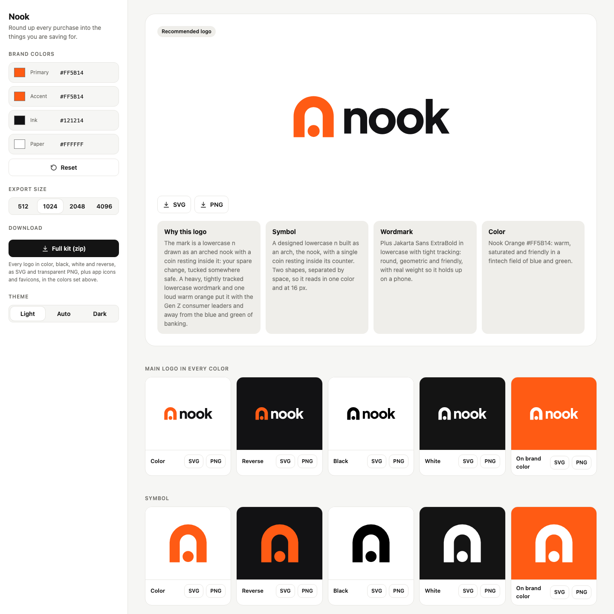
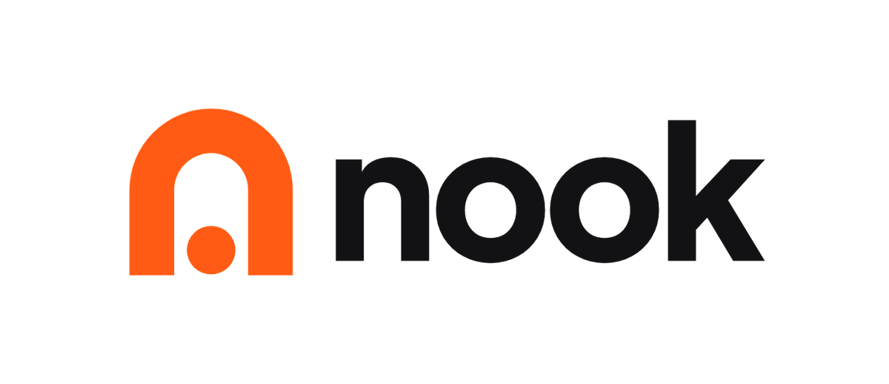
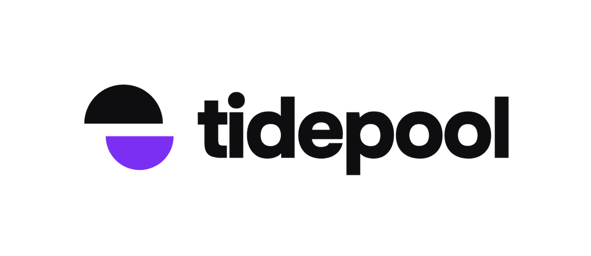
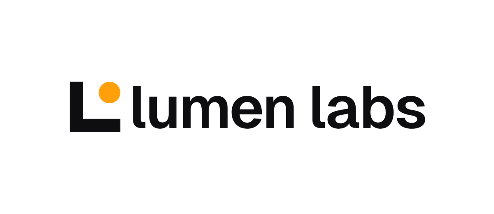

  

<h1 align="center">Brand Creator</h1>

  A Claude Code skill that turns a company name into a professional logo, wordmark and full brand kit, using research on 8,332 real tech logos.

  
  
  

## What it does

Tell Claude "create a brand for Acme, we make X". It first shows you three to five finished logo directions side by side and asks which one you want. Once you pick, it builds everything a startup needs for that choice: the logo in brand color, black, white and reverse, a wordmark, horizontal and stacked lockups, an app icon, favicons, a named palette and a brand board you can open in any browser. Every file comes as SVG with the type converted to outlines, and as transparent PNG.

Then keep talking to it. "Make the color more purple", "use option 3", "bigger text" or "give me the full assets" edit one spec file and rebuild the whole kit.

Nothing is a template. Every symbol is drawn fresh for the name, and the choices follow what the research found separates strong logos from weak ones: simple flat shapes, a designed initial or one geometric idea, one or two saturated colors, and a tight, heavy wordmark.

## Screenshots

| | |
|---|---|
|  |  |
|  |  |

These are made up companies from test runs: a savings app, a developer tool, an AI accounting company and a chip maker. Each was designed by an agent that only read the skill. This repo's own logo was made the same way.
