# dot-art

A Claude skill for making anything out of hexagons, octagons, LED pixels, dither or type, animated and in full colour, for Next.js and TypeScript.

You ask. Claude picks the technique, writes the scene, looks at its own renders until they hold up, and drops a typed React component into your project. The engine is WebGL2 with no runtime dependencies. Every loop is seamless.


<sub>One scene, eight surfaces. Top: hexagon, octagon, LED square, hexagon halftone. Bottom: plus, dither, type, words.</sub>

## Text objects

Things typeset in their own words.

> **A pink flower made of letters that types itself, blossoms, then blows away to its golden core**

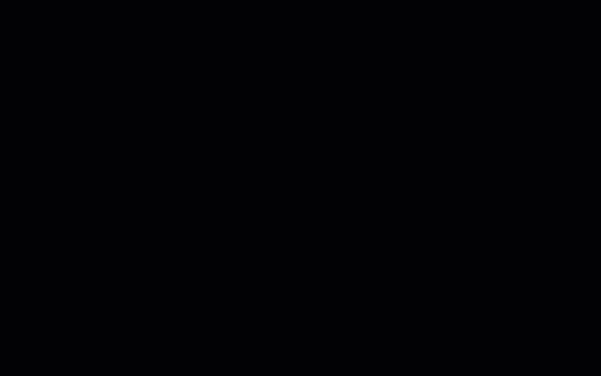

> **A cherry bonsai under a low moon, spelling hanami, with petals drifting off**


> **A DNA double helix typed in GATTACA**


> **Saturn in ASCII, with rings of drifting characters**


## Dot objects

> **Our nine product icons as inflated 3D shapes floating on a dark LED wall**


> **An iridescent torus knot in hexagons, turning slowly**


> **A glowing jellyfish made of octagons, drifting upward**


> **A blue morpho butterfly flapping, in LED squares**


## Dot backgrounds

> **Dithered ribbons of blue light on near-black, four colours only**

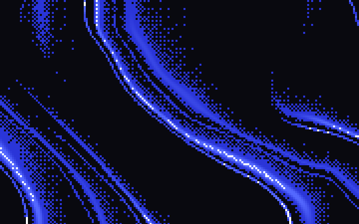

> **Desert dunes at golden hour as a newspaper print, merging octagons**

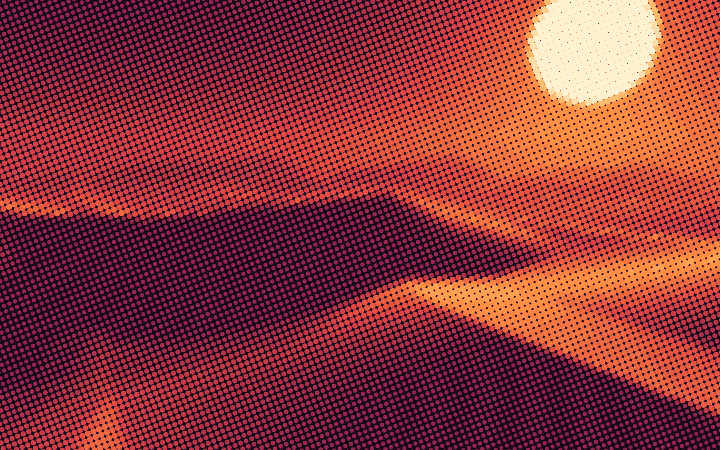

> **Streams of light squeezing through a narrow waist, LED pixels, calm centre for a headline**

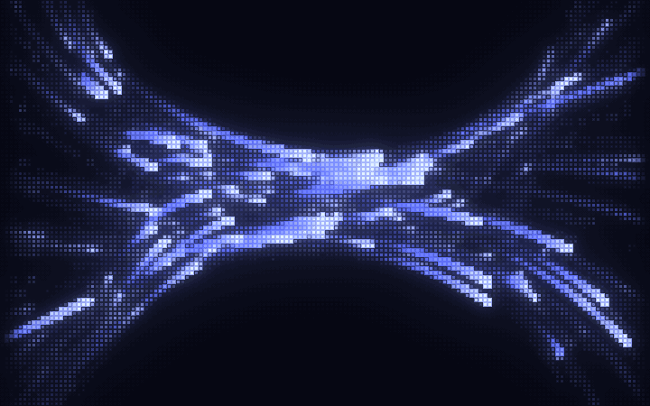

> **A total eclipse in octagons with a breathing corona**

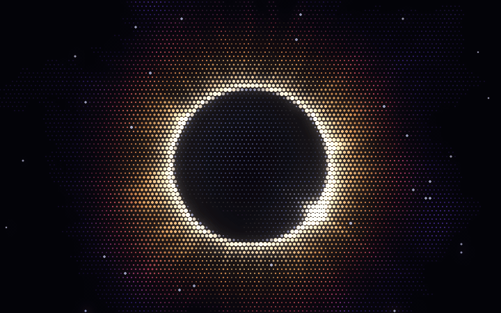

## Text backgrounds

Words repeated until they become a surface.

> **A tilted field of bevelled keys in ASCII, iridescent edges, dark behind the headline**

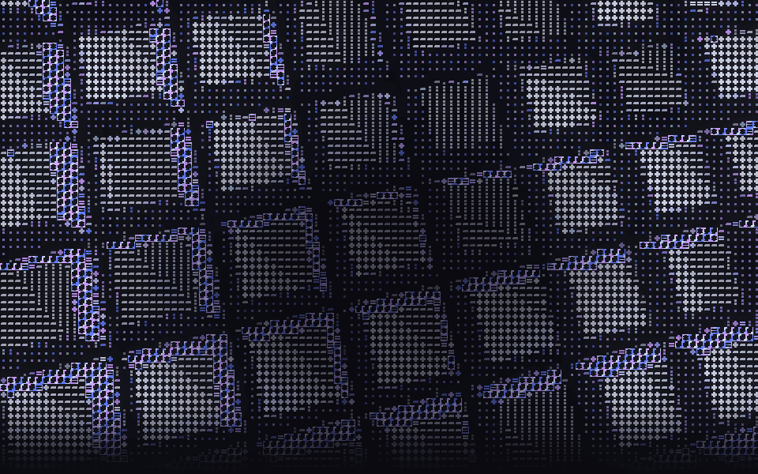

> **One sentence repeated edge to edge, moving like silk**

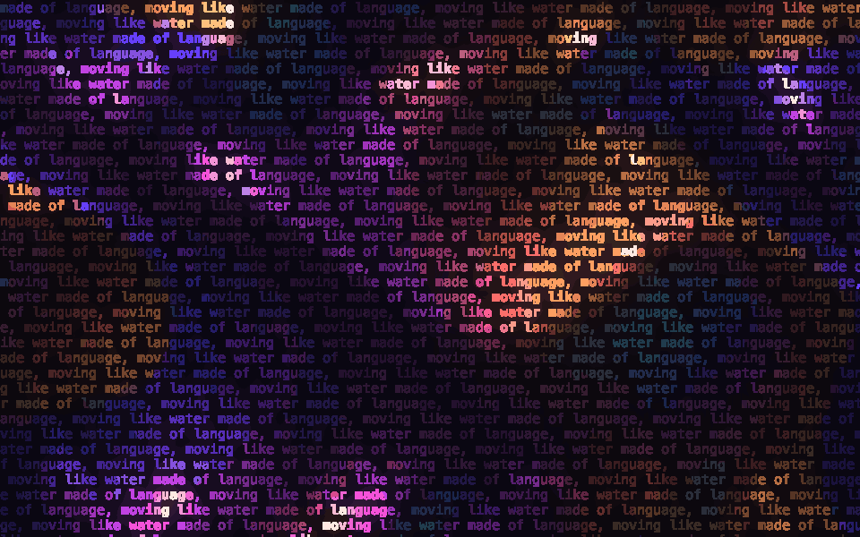

> **An ocean swell at night made of the word tide**


> **Rushing down a corridor of typed panels**

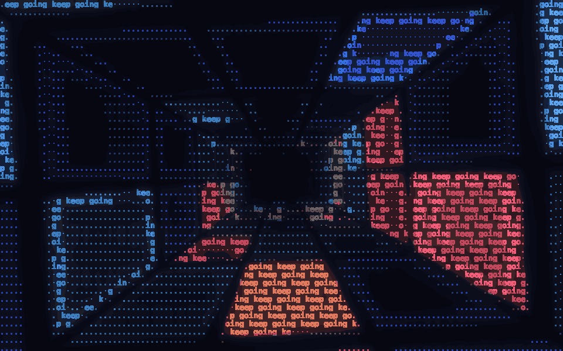

## Blind tests

Each of these came from a fresh Claude that had only this skill and the prompt.

> **A blue lotus made of letters. It opens from a bud, then wind strips it to its golden core. I want to make out the petals clearly**

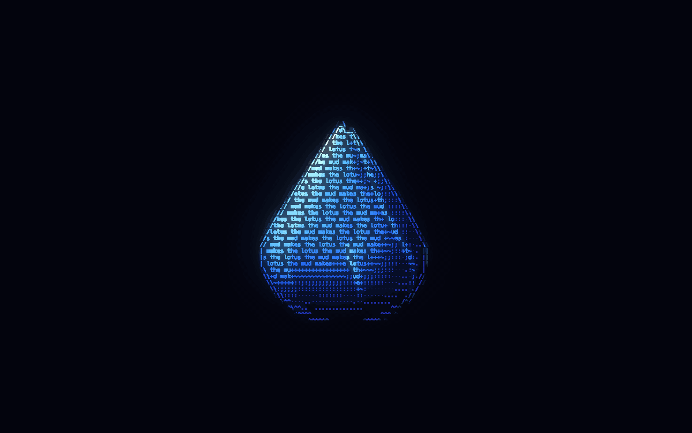

> **A hummingbird hovering, made of hexagons, emerald back, magenta throat that flashes as it turns, wings a blur**

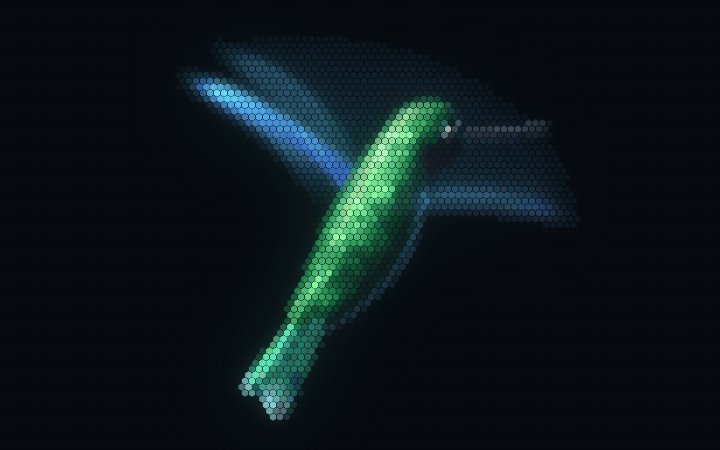

> **Aurora over a black treeline, octagon tiles, green into violet, room for a headline at the left**

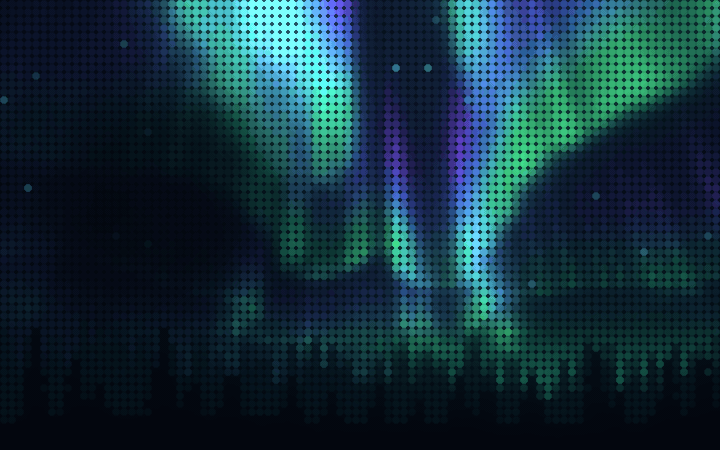

> **Rain on a window at night built from one sentence. Soft city lights behind, streaks refract the lines**

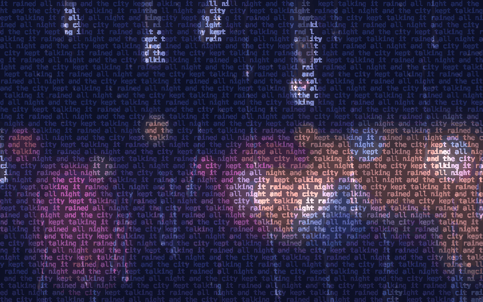

## Anything into dots

A photo:

> **Turn this photo into a neon LED wall, teal to magenta**

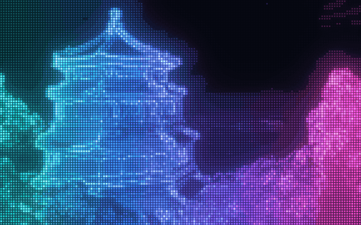

> **Turn this night photo into a neon LED wall, contours brighter than surfaces**

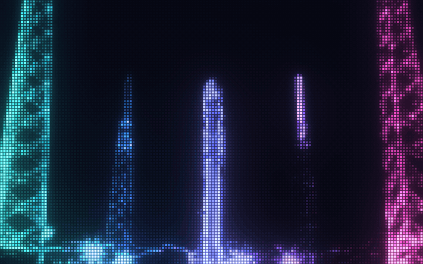

> **Turn this photo into a colour halftone of hexagons**

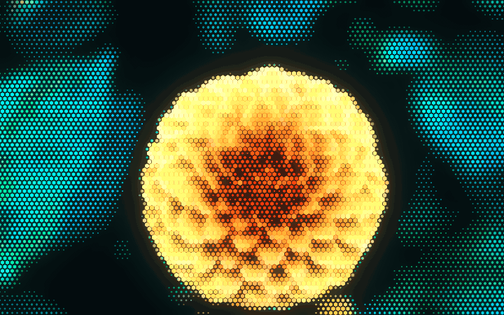

> **Set this photo in a countdown**

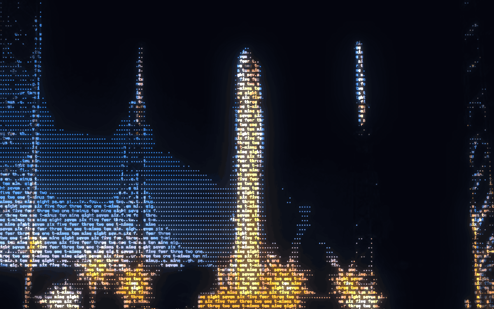

An existing scene, on another surface, in one line:

> **The same flower in hexagons, then in octagons**

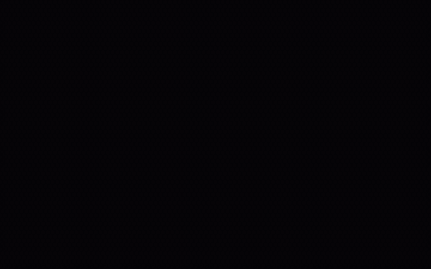
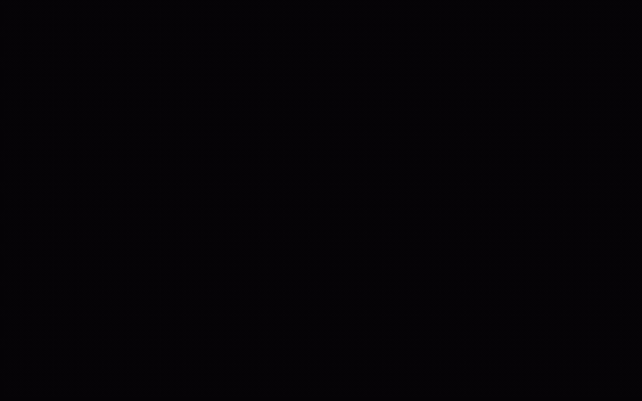

Also: an SVG or a word with `logoScene`, a `.glb` or `.obj` with `modelScene`.

## Install

For all your projects:

```bash
git clone --depth 1 https://github.com/edison16a/quality-art.git ~/.claude/skills/dot-art
```

```bash
cd ~/.claude/skills/dot-art/scripts && npm install
```

For one project, clone into that project's `.claude/skills/dot-art` instead.

The render scripts use Node 20+, an installed Chrome, and ffmpeg. The engine itself needs none of them.

Then ask. More prompts, including the ones that recreate each reference: [examples/prompts.md](examples/prompts.md).
