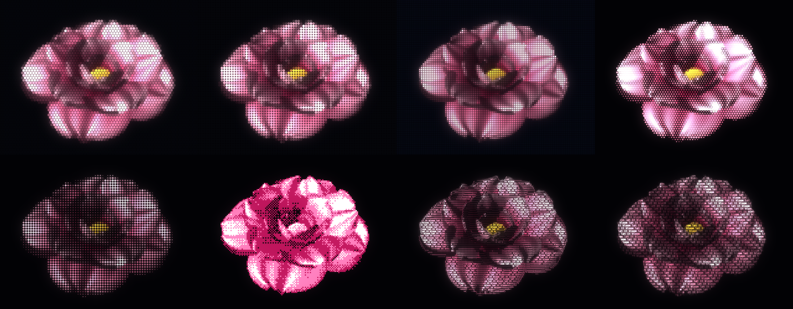
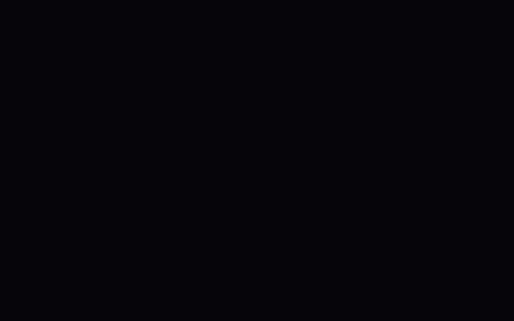
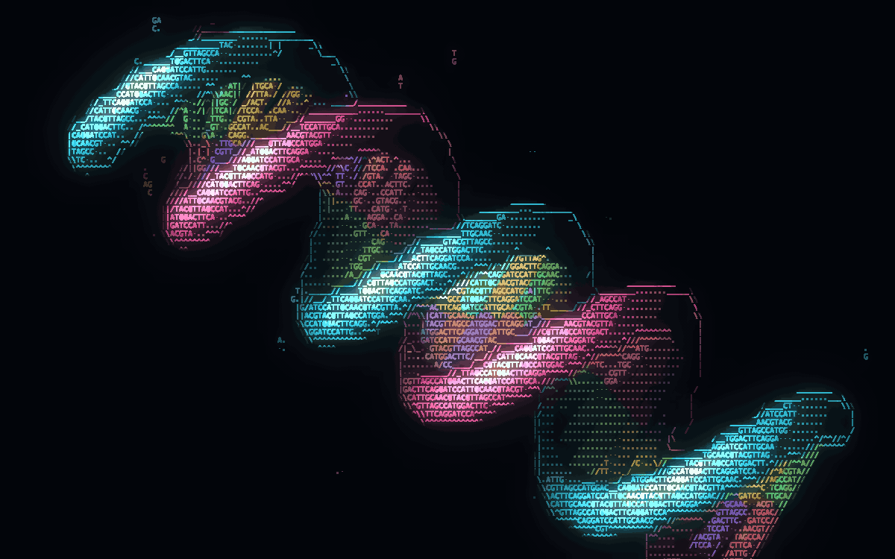
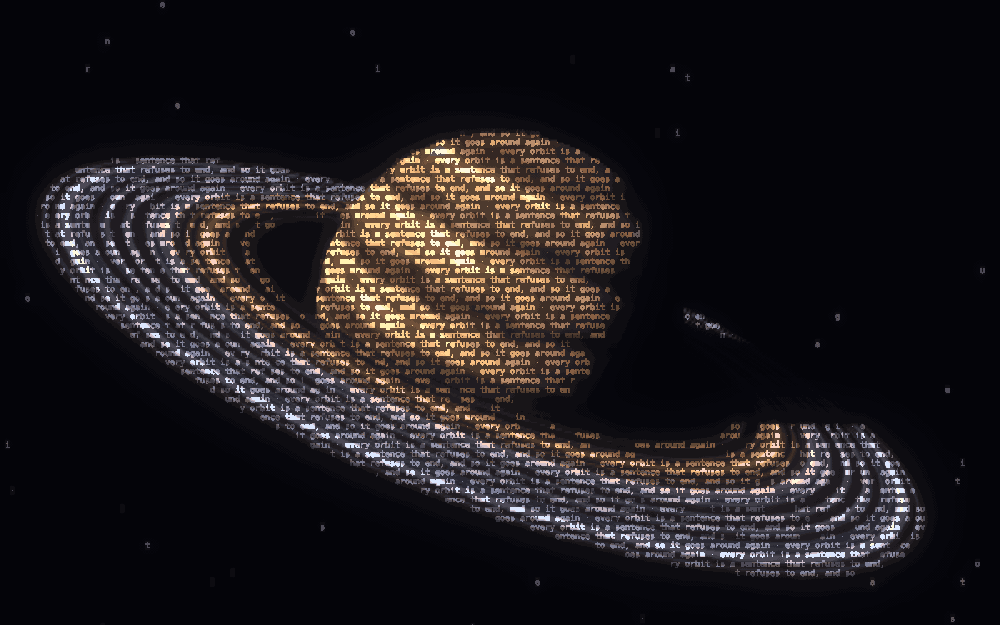
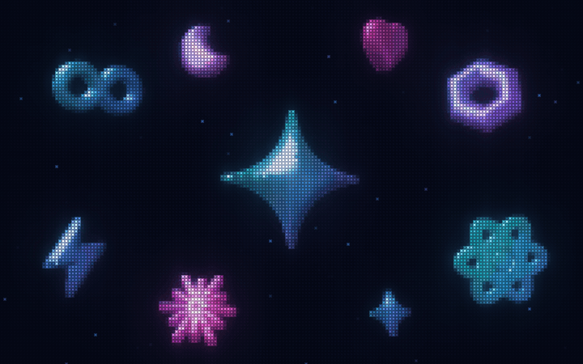
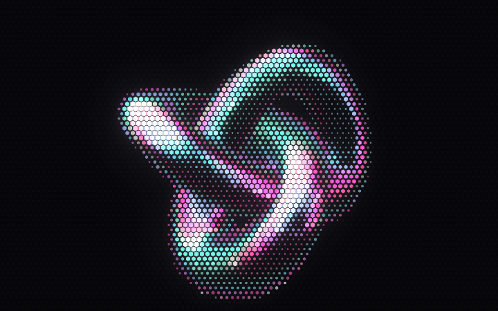
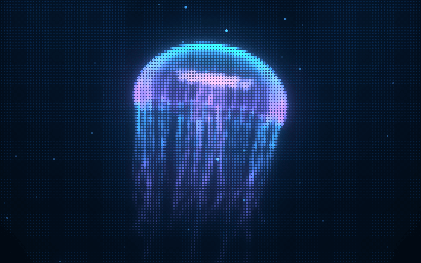
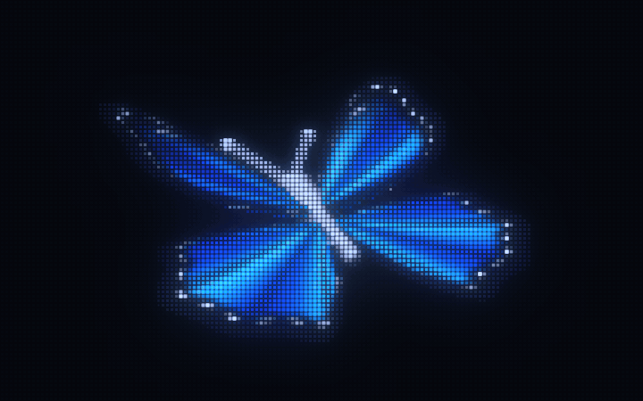

# dot-art

A Claude skill for making anything out of hexagons, octagons, LED pixels, dither or type, animated and in full colour, for Next.js and TypeScript.

You ask. Claude picks the technique, writes the scene, looks at its own renders until they hold up, and drops a typed React component into your project. The engine is WebGL2 with no runtime dependencies. Every loop is seamless.

One scene, eight surfaces. Top: hexagon, octagon, LED square, hexagon halftone. Bottom: plus, dither, type, words.

## Text objects

Things typeset in their own words.

> **A pink flower made of letters that types itself, blossoms, then blows away to its golden core**

> **A cherry bonsai under a low moon, spelling hanami, with petals drifting off**

> **A DNA double helix typed in GATTACA**

> **Saturn in ASCII, with rings of drifting characters**

## Dot objects

> **Our nine product icons as inflated 3D shapes floating on a dark LED wall**

> **An iridescent torus knot in hexagons, turning slowly**

> **A glowing jellyfish made of octagons, drifting upward**

> **A blue morpho butterfly flapping, in LED squares**

